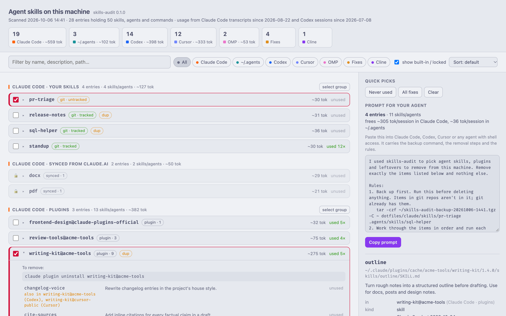
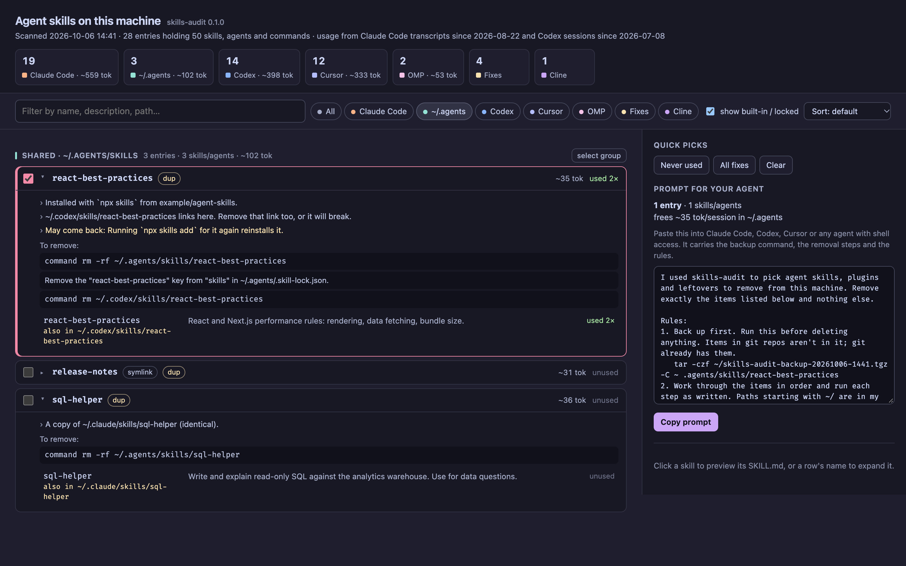

# skills-audit

skills-audit finds every agent skill installed on your machine, shows what each one costs in context and whether you actually use it, and writes a prompt that any coding agent can follow to remove the ones you pick.

<picture>
  <source media="(prefers-color-scheme: dark)" srcset="docs/screenshots/overview-dark.png">
  
</picture>

Skills pile up. Every installed skill puts its name and description into every session of the agent that loads it, and one plugin can bring in fifty at once. They live in `~/.claude`, `~/.codex`, `~/.cursor`, `~/.agents` and a handful of other folders, put there by plugin marketplaces, `npx skills`, copy-paste, and agents that write their own. Nothing shows them all in one place, and removing one properly depends on how it got there.

## Run it

Python 3.9 or newer, no dependencies, macOS or Linux.

```sh
uvx --from git+https://github.com/ggwelson/skills-audit skills-audit --open
```

Or install it with `pipx install git+https://github.com/ggwelson/skills-audit`, or clone the repo and run `PYTHONPATH=src python3 -m skills_audit --open`.

It writes `skills-browser.html` and `skills.json` to `~/.cache/skills-audit/` and opens the page. Add `--demo` to try it on a generated example home directory instead of yours.

## What it looks at

| Agent | Folders | Removable |
|---|---|---|
| Claude Code | `~/.claude/skills`, plugins listed in `~/.claude/plugins/installed_plugins.json` | yes |
| Claude Code | `~/.claude/skills/synced` (skills synced from claude.ai) | no, manage them in claude.ai |
| Shared | `~/.agents/skills` and the `npx skills` lock file | yes |
| Codex | `~/.codex/skills`, `~/.codex/memories/skills`, plugins enabled in `~/.codex/config.toml` or installed from a ChatGPT workspace | yes, workspace plugins by hand |
| Codex | `~/.codex/skills/.system` | no, ships with Codex |
| Cursor | `~/.cursor/skills`, plugins in `~/.cursor/plugins/cache` | plugins by hand in Cursor's settings |
| Cursor | `~/.cursor/skills-cursor` | no, ships with Cursor |
| OMP | `~/.omp/agent/managed-skills` | yes |
| Others | the skill folders of Cline, OpenCode, Gemini CLI, GitHub Copilot, Windsurf, Goose, Roo Code, Kiro, Qwen Code, Factory and Amp | yes |

It also flags leftovers it can fix: stale entries in the `npx skills` lock file, broken symlinks, a Claude Code plugin list that has drifted from your chezmoi source, claude.ai-synced skills landing inside a git repo, and skill deletions you haven't committed.

Skills built into the `claude` binary don't exist as files, so they aren't listed.

## Using the page

Each row is one thing you can remove: a skill folder, a symlink, a whole plugin, or a fix. Plugins come out as a unit because that's how their tools uninstall them.

Rows show the context cost (the tokens of name and description loaded into every session) and how often you used it. Claude Code plugin costs come from `claude plugin details`; everything else is an estimate from the text length. Expand a row to see notes and the exact removal steps, and click a skill to read its `SKILL.md`. Badges mark git state, duplicates across folders, symlinks, broken links and manual steps.

Filter by agent or text, sort by context cost or by least used, or use the quick picks: never used, or all fixes. Tick what you want gone, press **Copy prompt**, and paste it into Claude Code, Codex, Cursor or any agent that can run shell commands. Your ticks survive a reload.



## The prompt

The prompt carries everything the agent needs: a backup command for anything not already in git, the steps for each item, and rules for doing it safely. This one comes from `--demo`:

```text
I used skills-audit to pick agent skills, plugins and leftovers to remove from this machine. Remove exactly the items listed below and nothing else.

Rules:
1. Back up first. Run this before deleting anything. Items in git repos aren't in it; git already has them.
   tar -czf ~/skills-audit-backup-20261006-1441.tgz -C ~ dotfiles/claude/skills/pr-triage .agents/skills/react-best-practices
2. Work through the items in order and run each step as written. Paths starting with ~/ are in my home directory. Use `command rm` so shell aliases such as `rm -i` can't block you. Removing a symlink removes only the link; leave its target alone unless an item says otherwise.
3. Steps marked MANUAL can't be done from a shell. Skip them and list them for me at the end.
4. If a step fails, or what you find doesn't match the description, stop work on that item, tell me what you saw, and carry on with the rest.
5. Don't commit or push. Leave changes made with `git rm` or `git add` staged for me to review.
6. When you're done, check that each path is gone and each plugin no longer shows in its tool's plugin list. Then report what you removed, what failed, which MANUAL steps are left, and which items may come back.

Items (5), from a skills-audit 0.1.0 scan on 2026-10-06 14:41:

1. Claude Code skill "pr-triage" in ~/.claude/skills
   Where: ~/.claude/skills/pr-triage
   Steps:
   - `command rm -rf ~/dotfiles/claude/skills/pr-triage`
   Note: In the git repo ~/dotfiles but not tracked, so git has no copy. The backup step covers it.

2. Claude Code plugin writing-kit@acme-tools (8 skills, 1 agent)
   Where: ~/.claude/plugins/cache/acme-tools/writing-kit/1.4.0
   Steps:
   - `claude plugin uninstall writing-kit@acme-tools`

3. Skill folder "react-best-practices" in ~/.agents/skills, the shared folder Codex and other agents read
   Where: ~/.agents/skills/react-best-practices
   Steps:
   - `command rm -rf ~/.agents/skills/react-best-practices`
   - Remove the "react-best-practices" key from "skills" in ~/.agents/.skill-lock.json.
   - `command rm ~/.codex/skills/react-best-practices`
   Note: Installed with `npx skills` from example/agent-skills.
   Note: ~/.codex/skills/react-best-practices links here. Remove that link too, or it will break.
   May come back: Running `npx skills add` for it again reinstalls it.

4. Cursor plugin linear from the cursor-public marketplace (2 skills)
   Where: ~/.cursor/plugins/cache/cursor-public/linear/dac1a0
   Steps:
   - MANUAL: In Cursor, open Settings > Plugins and uninstall linear. Cursor has no command for this.

5. Entries in the `npx skills` lock file whose folders are already gone
   Where: ~/.agents/.skill-lock.json
   Steps:
   - Remove these keys from "skills" in ~/.agents/.skill-lock.json: prompt-golf, tdd-coach.
   Note: Already deleted: prompt-golf, tdd-coach
```

Rule 2 exists because a common `alias rm='rm -i'` makes an agent's `rm` wait for a "y" that never comes.

## How it picks the removal steps

- A skill folder tracked in a git repo, such as a dotfiles repo that `~/.claude/skills` links into, comes out with `git rm` and stays staged for you to commit.
- An untracked or unmanaged folder is deleted after the backup.
- A folder chezmoi manages comes out with `chezmoi destroy`, which removes the source copy too. If chezmoi manages `~/.claude/settings.json`, plugin removals include deleting the plugin from your chezmoi source, so the next `chezmoi apply` doesn't turn it back on.
- A symlink comes out on its own and its target stays. When you remove a folder, links elsewhere that point at it go with it.
- Claude Code plugins use `claude plugin uninstall`, and their marketplace goes too if no other installed plugin needs it. Codex plugins use `codex plugin remove`; plugins bundled with Codex get disabled in `config.toml` instead. Cursor plugins and Codex plugins from a ChatGPT workspace have no command, so those steps are manual.
- Skills installed by `npx skills` are also dropped from its lock file. Skills Codex wrote from its memories are also unlinked from `~/.codex/memories/MEMORY.md`.

## Where the usage numbers come from

For Claude Code it counts `Skill` tool calls and slash commands in the transcripts under `~/.claude/projects`. For Codex it counts reads of `SKILL.md` files in the session logs under `~/.codex/sessions`, since Codex reads the file whenever it uses a skill. Claude Code deletes old transcripts after a while, so the page shows the date range the counts cover. Cursor, OMP and the other agents keep no logs it can read, so their rows say "usage n/a".

## Privacy

It runs entirely on your machine and sends nothing anywhere. It reads files under your home directory and runs `git`, `chezmoi` and `claude plugin details` when they're installed; `--offline` skips the last two. The page it writes embeds skill descriptions and the start of each `SKILL.md`, so share it with the same care as those files.

## Options

| Flag | Effect |
|---|---|
| `--open` | open the page in your browser when done |
| `--out DIR` | write the page and JSON somewhere other than `~/.cache/skills-audit` |
| `--json` | print the inventory as JSON instead of writing files |
| `--no-usage` | skip reading transcripts |
| `--offline` | don't call the `claude` or `chezmoi` CLIs |
| `--home DIR` | scan another folder as if it were your home directory |
| `--demo` | scan a generated example home directory |

## Development

```sh
PYTHONPATH=src python3 -m unittest discover -s tests   # runs against the demo home
scripts/screenshots.sh                                  # rebuilds docs/screenshots with headless Chrome
```

The page can take its state from the URL hash, which is how the screenshot script sets it up: `#select=ID,ID&open=ID&focus=ID|N&q=text&agent=codex&sort=cost`. IDs are in `skills.json`.

## License

MIT
